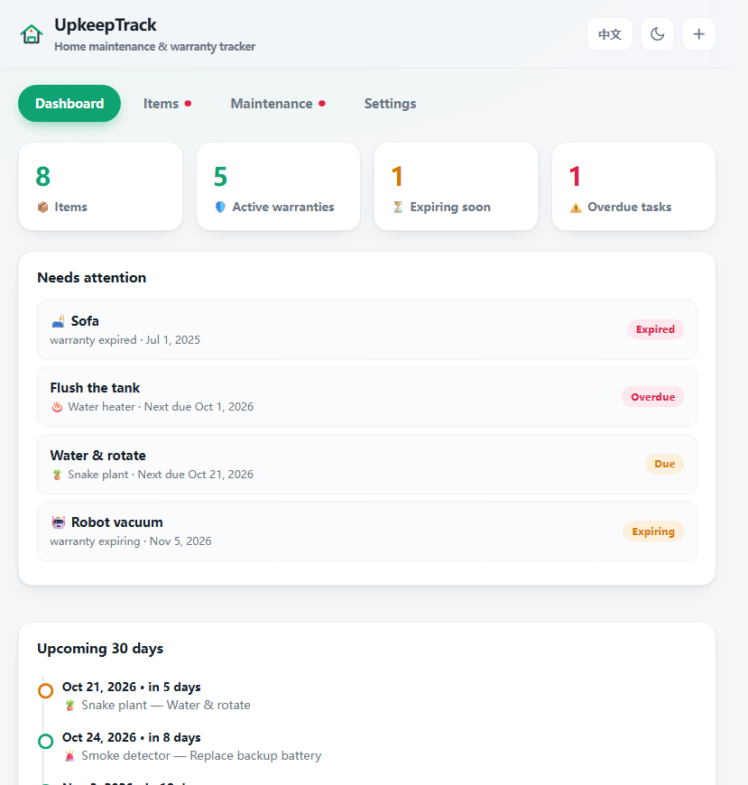
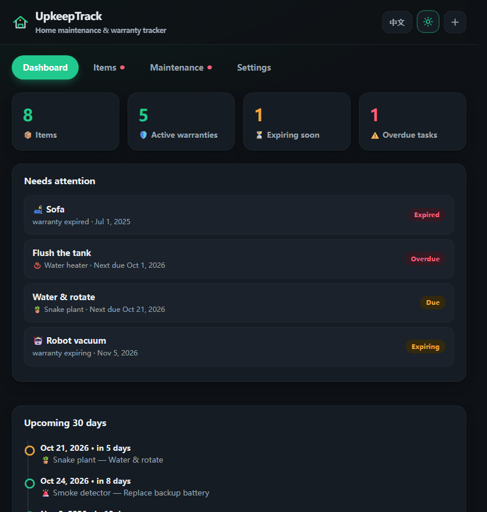
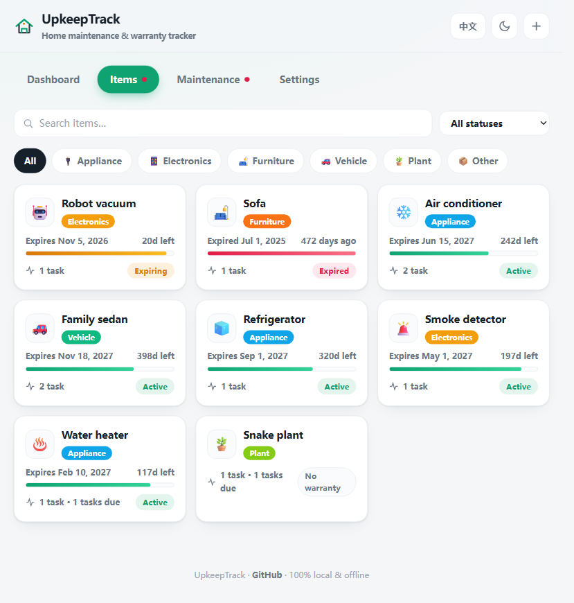
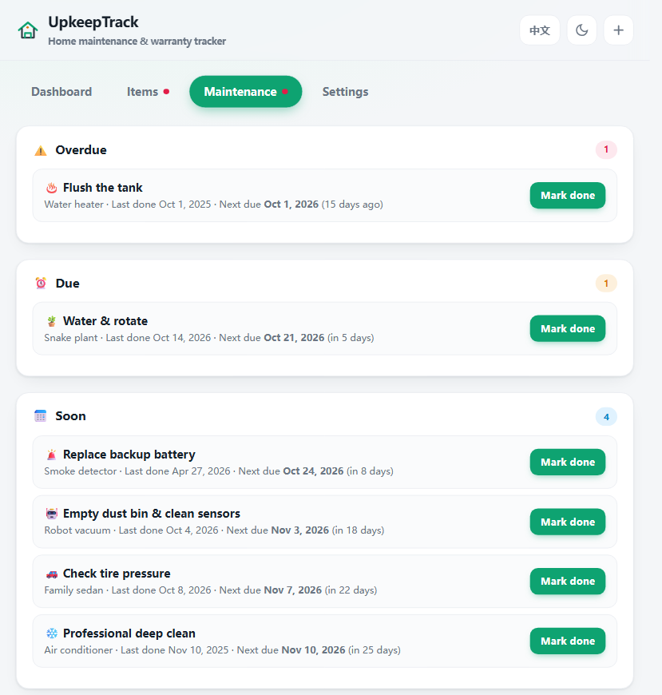
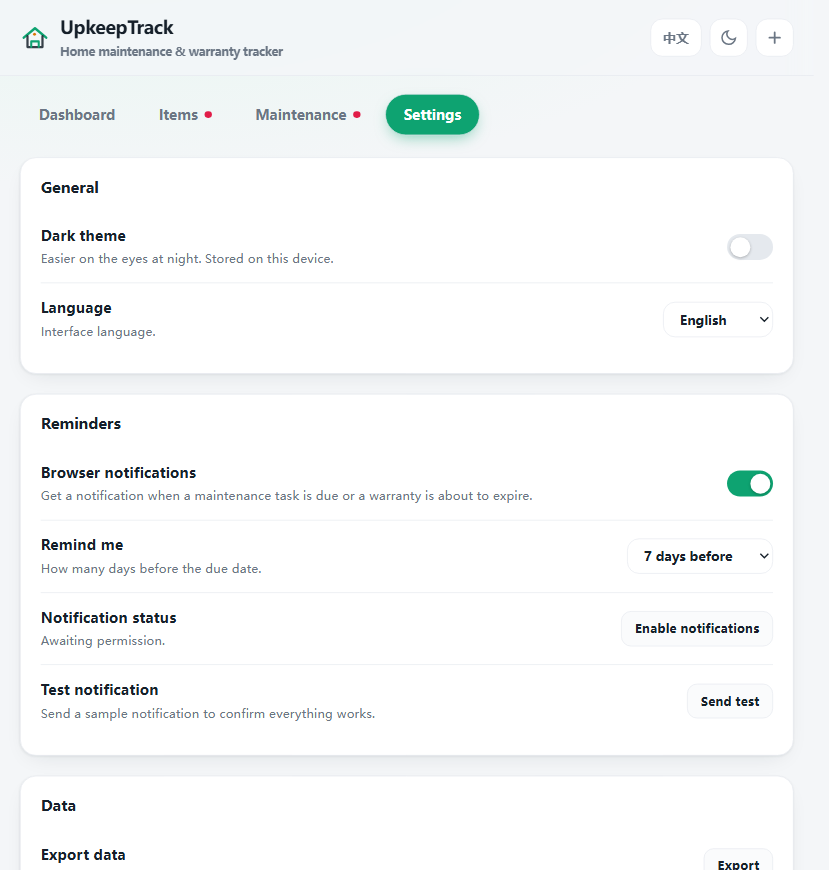
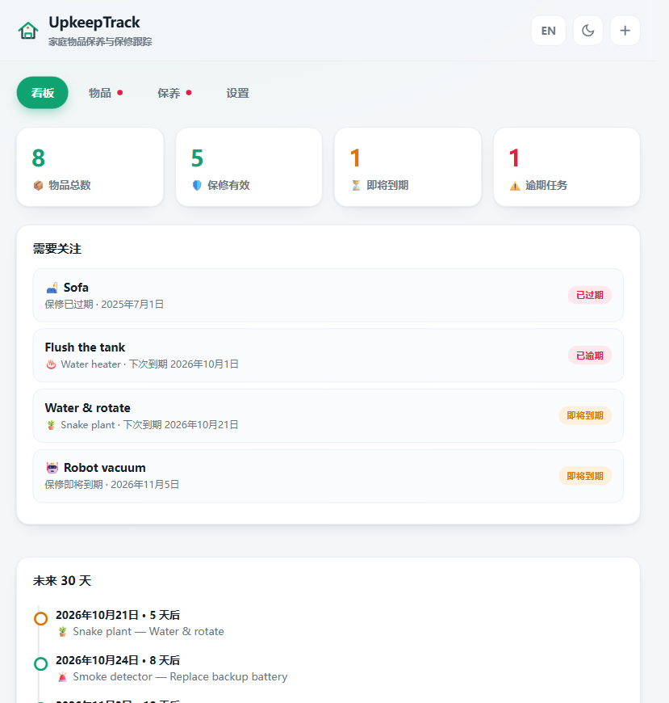

# 🏠 UpkeepTrack

**Home Maintenance & Warranty Tracker** — keep every item you own in shape: track warranties, schedule recurring maintenance, and never miss a "when did I last…?" question again.

A **zero-install, offline-first, single-file** web app built with vanilla JavaScript. Open it in any browser — no server, no build step, no dependencies, no account.

## Why this exists

Warranty and maintenance tracking usually means one of two things:

- **Home Assistant plugins** — powerful, but they require installing and running a full Home Assistant server.
- **Self-hosted apps** (e.g. HomeBox, Warracker) — a whole backend, Docker, database, users, roles…

UpkeepTrack takes the opposite route: **one HTML file you double-click**. Your data never leaves your device. It combines what those tools split apart — **warranty expiry tracking AND recurring maintenance task scheduling** — in a clean, modern interface.

## ✨ Features

| | |
|---|---|
| 🛡️ **Warranty tracking** | purchase date + warranty length → automatic status (`Active` / `Expiring` / `Expired`), progress bar, days-left countdown |
| 🧰 **Recurring maintenance** | tasks with custom intervals (e.g. "wash AC filter every 90 days"); next due date is computed from the last time you did it |
| ✅ **One-click "Mark done"** | logs the date automatically and schedules the next occurrence |
| 🔔 **Browser notifications** | optional reminders when a task comes due or a warranty expires — lead time configurable (same day / 1 / 3 / 7 days) |
| 📊 **Dashboard** | stats, a "needs attention" list (expiring warranties + overdue tasks) and a 30-day timeline |
| 🔍 **Search & filters** | full-text search, category chips, warranty-status filter |
| 🌐 **Bilingual** | English and 中文, switchable in one click |
| 🌗 **Dark / light themes** | persisted per device |
| 💾 **Data safety** | everything is stored in `localStorage`; export/import JSON backups; built-in demo data |
| 🔒 **Private by design** | 100% local, 100% offline — no network calls, no tracking, no accounts |

## 📸 Screenshots

| Light dashboard | Dark dashboard |
|---|---|
|  |  |

| Items grid | Maintenance view |
|---|---|
|  |  |

| Settings | Chinese UI |
|---|---|
|  |  |

## 🚀 Quick start

**Option A — just use it:** download [`index.html`](index.html) and open it in any modern browser (Chrome, Edge, Firefox, Safari).

**Option B — clone & run:**

```bash
git clone https://github.com/Koiliblly/UpkeepTrack.git
cd UpkeepTrack
# open index.html in your browser, or:
#   python -m http.server 8080  → http://localhost:8080
```

That's it. No `npm install`, no build, no server required.

## 📖 Usage

1. **Items** — add your things (name, icon, category, purchase date, warranty length, notes). Cards show warranty progress and status at a glance; click any card for details.
2. **Maintenance** — add tasks inside an item's detail view (`e.g. 90 days for an air filter, 180 for oil changes`). Every task shows *last done* and *next due*.
3. **Dashboard** — start your day here: what's expiring, what's overdue, what's coming in the next 30 days.
4. **Settings** — toggle theme/language, load demo data, or export/import a JSON backup.

> 💡 Tip: after you finish a task, hit **Mark done** — UpkeepTrack automatically moves the task to its next due date.

> 🔔 Reminders: browser notifications need a secure context. Open the app via `http://localhost` (e.g. `python -m http.server`) or https, keep the tab open, and enable them in **Settings → Reminders**. On `file://` they are unavailable and the app tells you why.

## 🔐 Privacy

- All data lives in your browser's `localStorage` on **your** device.
- The app makes **zero network requests** — it works fully offline.
- Browser notifications (if enabled) are generated locally by your browser and never leave your device.
- No analytics, no cookies, no accounts, no servers.

## 🛠 Tech

- 100% vanilla HTML + CSS + JavaScript — **zero dependencies**, ~60 KB single file.
- No frameworks, no CDNs, no build tooling. Readable, commented, easy to fork.

## 📄 License

[MIT](LICENSE) © 2026 [Koiliblly](https://github.com/Koiliblly)

---

**Made with ☕ and zero `npm install`.** Star it if you find it useful, and feel free to open issues or PRs!
